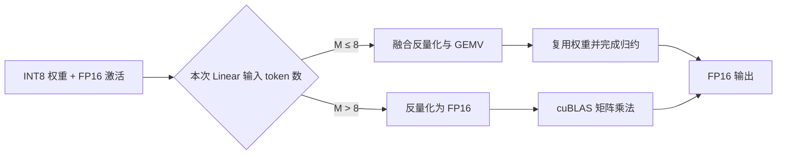

# vLLM-Turing-W8A16：面向 NVIDIA T4 的低批量解码优化实践

基于 vLLM 二次开发，面向 Turing（sm75，如 NVIDIA T4）实现 W8A16 Triton GEMV 内核。在已记录的 T4、Qwen3.5-9B Linear 形状测试中，M=1/2/4 时相对 cuBLAS FP16 的算子加速比分别为 **2.14× / 1.91× / 1.13×**。

> 当前结果为算子级测试，不代表端到端吞吐或 TTFT 收益。上游 vLLM 版本、项目地址及完整测试环境尚需补充，不能直接标注为 v0.6.x。

## 1. 背景与问题

大模型逐 token 解码时，Linear 层通常只处理少量 token。此时权重读取开销较突出，计算容易受到显存带宽限制。W8A16 使用 INT8 权重与 FP16 激活，相比 FP16 权重可减少约一半的**权重数据读取量**，但实际收益取决于反量化、访存和归约的实现。

T4 属于 Turing 架构，不支持 Ampere 引入的 `cp.async`。面向新架构优化的内核未必适合它；同时，INT8 Tensor Core 也不能直接执行 INT8 权重与 FP16 激活的混合乘法。因此，本项目针对 **M≤8 的小批量解码**，实现融合反量化与乘加的 Triton GEMV，通过权重复用、向量化访存和延后归约降低开销。



## 2. 我的改动

### 模块 A：面向小批量解码的 Triton GEMV

实现 `TritonW8A16GemvLinearKernel`，将小 M 场景下的计算组织为带宽导向的 GEMV：

- **每个 program 处理一个输出通道**：同一行 INT8 权重在 program 内供多行激活复用，减少重复读取。
- **融合反量化与乘加**：小批量路径不生成完整的 FP16 权重临时张量。
- **将归约移到 K 循环之外**：循环内使用 FP32 累加器，结束后统一归约，减少循环内归约带来的延迟。
- **减少带 mask 的访存**：host 侧将 M 补齐到 2 的幂，并选择能够整除 K 的 `BLOCK_K`，为向量化访存创造条件。

`BLOCK_K` 从 1024、512、256、128 中按规则选择，`num_warps` 固定为 4。该方案优先服务 T4 小批量解码，尚未引入 autotune。

核心文件：[`triton_w8a16_gemv.py`](./vllm/model_executor/kernels/linear/mixed_precision/triton_w8a16_gemv.py)

### 模块 B：权重布局转换与加载显存控制

模型加载后，将 compressed-tensors 的打包权重转换为 K 方向连续的 INT8 布局：

```text
加载格式：
weight_packed [N, K/4]  INT32
weight_scale  [N, K/128] FP16

运行格式：
weight_packed [N, K]    INT8
weight_scale  [N, K/128] FP16
```

按每块 8192 行分批解包，避免一次性展开产生过大的 INT32 中间张量。转换发生在加载阶段，推理时直接使用转换后的布局。

### 模块 C：可选启用、内核选择与大批量回退

通过 `VLLM_W8A16_TRITON_GEMV=1` 显式启用，默认关闭。只有量化配置匹配时才参与内核选择；不满足条件的层继续选择后续候选内核。

对于已选中本实现的层：

| 场景 | 执行路径 | 设计取舍 |
|---|---|---|
| M≤8 | Triton 融合 GEMV | 优先降低权重读取与反量化开销 |
| M>8 | 反量化后调用 cuBLAS FP16 | 使用成熟的矩阵乘法实现，但每次调用会产生 FP16 权重临时张量 |

相关文件：

- [`linear/__init__.py`](./vllm/model_executor/kernels/linear/__init__.py)：注册内核选择优先级。
- [`mixed_precision/__init__.py`](./vllm/model_executor/kernels/linear/mixed_precision/__init__.py)：导出内核类。

**当前硬件判断存在边界问题：**能力下限设为 sm75，且内核排在候选列表首位，因此开启后也可能在 A100/H100 等更新 GPU 上抢占其他实现。目前应仅在目标 T4/Turing 环境启用。

### 模块 D：编译流程适配

通过 `direct_register_custom_op("w8a16_triton_gemv", ...)` 注册 opaque custom op，并提供 `fake_impl`。

这样可避免 Inductor 深入追踪反量化表达式，减少原记录中 sm75 编译阶段组合内核 benchmark 引发的长时间等待。

## 3. Benchmark 结果

### 硬件与测试范围

以下结果整理自原文引用的源码 docstring，未在本次改写中重新测试。

| 项目 | 配置 |
|---|---|
| GPU | NVIDIA T4，sm75 |
| 测试对象 | Qwen3.5-9B 的 Linear 形状 |
| 权重 / 激活 | INT8 / FP16 |
| group_size | 128 |
| 基线 | cuBLAS FP16 |
| 测量范围 | Linear 算子级性能 |
| 待补充信息 | 软件版本、完整形状列表、计时脚本、预热与重复次数、结果聚合方式 |

M 表示**当前 Linear 调用处理的 token 数**，不一定等于请求并发数。

### 性能对比

以 cuBLAS FP16 的执行速度为 1.00×：

| M | cuBLAS FP16 | 本项目 Triton GEMV |
|---:|---:|---:|
| 1 | 1.00× | **2.14×** |
| 2 | 1.00× | **1.91×** |
| 4 | 1.00× | **1.13×** |

收益随 M 增大而收窄。M>8 使用回退路径，目前不宣称存在加速收益。

原记录另报告同硬件上 Marlin 约为 cuBLAS FP16 的 0.94×；由于缺少对应版本、配置与执行路径记录，该结果仅作为背景参考。

### 测试方法与控制变量

完整复现应固定 GPU、软件版本、矩阵形状、输入数据、量化参数及计时方式，统一预热，并使用 CUDA Event 或正确同步后的 GPU 计时。算子测试应计入调用所需的 padding、反量化等开销，避免只比较内核主体。

**“原版 vLLM vs 修改版”的端到端对比尚待补充。**该测试还需固定模型 checkpoint、输入与输出长度、并发数、调度配置和采样参数，报告吞吐、TTFT、TPOT 与峰值显存。当前不能用上述算子加速比替代这些指标。

## 4. 快速复现

> 以下为复现步骤框架。仓库地址、上游 commit、依赖版本和模型 ID 尚未提供；补齐并验证这些信息后，才能承诺 clone 后直接运行。

### 4.1 环境搭建

准备 NVIDIA T4 环境，克隆包含本内核的项目，并按项目锁定的依赖版本安装：

```bash
git clone https://github.com/lostwithin/vllm.git
cd vllm

# 按该分支的构建说明安装匹配的 PyTorch、CUDA 与 Triton。
pip install -e .
```

应在发布前明确记录 vLLM 基础 commit、Python、PyTorch、CUDA 和 Triton 版本。

### 4.2 下载兼容模型

模型需采用受支持的 compressed-tensors W8A16 配置：

| 配置项 | 要求 |
|---|---|
| 权重量化类型 | `scalar_types.uint8b128` |
| 激活 dtype | `torch.float16` |
| group_size | 128 |
| zero points | 不支持 |
| `g_idx` / act-order 重排 | 不支持 |
| K 对齐 | TP 分片后的 K 必须能被 128 整除 |

使用实际兼容的模型 ID 下载 checkpoint：

```bash
hf download <兼容的W8A16模型ID> --local-dir ./models/w8a16
```

### 4.3 启动服务

以下命令适用于 Linux Bash：

```bash
VLLM_W8A16_TRITON_GEMV=1 \
vllm serve ./models/w8a16 --dtype float16
```

生效后，应出现日志：

```text
TritonW8A16GemvLinearKernel active (sm75 W8A16 GEMV)
```

该环境变量在 layer 构造阶段读取，必须在引擎启动前设置。关闭时移除该变量并重启服务，或通过以下配置排除内核：

```bash
VLLM_DISABLED_KERNELS=TritonW8A16GemvLinearKernel \
vllm serve ./models/w8a16 --dtype float16
```

### 4.4 数值验证

以下示例直接调用底层函数，不需要启动服务：

```python
import torch
from vllm.model_executor.kernels.linear.mixed_precision.triton_w8a16_gemv import (
    triton_w8a16_gemv,
)

torch.manual_seed(0)
M, N, K, G = 4, 4096, 4096, 128

x = torch.randn(M, K, device="cuda", dtype=torch.float16)
w_q = torch.randint(
    -127, 128, (N, K), device="cuda", dtype=torch.int8
)
w_s = (
    torch.rand(N, K // G, device="cuda", dtype=torch.float16)
    * 0.01 + 1e-3
)

w_deq = (
    w_q.view(N, K // G, G).float()
    * w_s.view(N, K // G, 1).float()
).view(N, K)

ref = x.float() @ w_deq.t()
out = triton_w8a16_gemv(x, w_q, w_s, G)

error = out.float() - ref
print("max abs err:", error.abs().max().item())
print("rel err:", (error.norm() / ref.norm()).item())
```

该脚本用于观察误差，尚未定义通过阈值。正式测试需要覆盖不同 M、N、K，以及 M=8/9 的路径切换边界。

## 5. 局限与后续计划

- **适用范围较窄。**当前仅支持 `uint8b128`、FP16 激活、`group_size=128`，不支持 zero points 和 act-order。后续优先完善配置覆盖与错误提示。
- **硬件选择条件需要收紧。**当前允许 sm75+ 设备选中该内核，后续应限制目标架构或引入性能判断，避免影响更新 GPU 的内核选择。
- **大批量路径存在额外成本。**M>8 每次调用都会反量化并生成完整 FP16 权重临时张量，需要评估其延迟和峰值显存。
- **部分形状利用率不足。**每个 program 负责一个输出通道，N 较小时可能无法充分利用 GPU；非 2 的幂 M 还会产生 padding 拷贝。
- **参数仍为启发式配置。**后续可根据形状调整 `BLOCK_K`、warp 数以及 GEMV 切换阈值。
- **测试体系尚不完整。**目前缺少正式单元测试和端到端 benchmark，需要补充边界形状、TP 分片、数值误差及服务性能测试。

数值方面，小批量路径采用 FP32 反量化与累加，但浮点乘法、累加和最终 FP16 写回仍可能产生舍入误差。它与“先反量化为 FP16 再调用 cuBLAS”的路径可能存在差异，不能仅凭累加 dtype 就保证所有情况下误差更小或完全一致。

仓库地址已补充，README 对应部分可改为：

### 环境搭建

```bash
git clone https://github.com/lostwithin/vllm.git
cd vllm

# 按该分支的构建说明安装匹配的 PyTorch、CUDA 与 Triton。
pip install -e .
```

### 核心改动文件

- [triton_w8a16_gemv.py](https://github.com/lostwithin/vllm/blob/HEAD/vllm/model_executor/kernels/linear/mixed_precision/triton_w8a16_gemv.py)：W8A16 GEMV、权重转换与大批量回退。
- [linear/__init__.py](https://github.com/lostwithin/vllm/blob/HEAD/vllm/model_executor/kernels/linear/__init__.py)：内核注册与选择优先级。
- [mixed_precision/__init__.py](https://github.com/lostwithin/vllm/blob/HEAD/vllm/model_executor/kernels/linear/mixed_precision/__init__.py)：导出内核类。

## 致谢

本项目基于 [vllm-project/vllm](https://github.com/vllm-project/vllm) 二次开发，上游采用 Apache License 2.0。感谢 vLLM、Triton 及相关开源社区提供的基础设施。

原版 README 归档位置：[`docs/UPSTREAM_README.md`](./docs/UPSTREAM_README.md)
