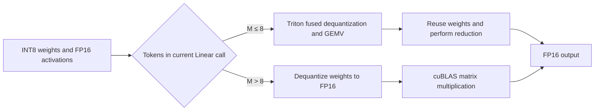

# vLLM-Turing-W8A16: Low-Batch Decode Optimization for NVIDIA T4

Based on **vLLM v0.28.0**, this project implements a W8A16 Triton GEMV kernel that fuses dequantization and multiply-accumulate operations for Turing GPUs (sm75, such as NVIDIA T4). With **qwen3.5-9B-w8a16**, end-to-end A/B testing shows an approximately **10% improvement in decode throughput**. In recorded T4 tests using qwen3.5-9B-w8a16 Linear shapes, operator speedups over cuBLAS FP16 were **2.14× / 1.91× / 1.13×** for M=1/2/4.

Repository: [lostwithin/vllm](https://github.com/lostwithin/vllm)

## 1. Background and Problem

During token-by-token decoding, Linear layers typically process only a small number of tokens. Weight reads become a significant cost, and execution is often limited by GPU memory bandwidth. W8A16 uses INT8 weights and FP16 activations, reducing **weight data traffic** by roughly half compared with FP16 weights. Actual gains still depend on the implementation of dequantization, memory accesses, and reductions.

T4 uses the Turing architecture and does not support `cp.async`, introduced with Ampere. Kernels optimized for newer architectures may therefore be unsuitable for T4. INT8 Tensor Cores also cannot directly multiply INT8 weights by FP16 activations. This project targets **small-batch decode with M≤8**, using a bandwidth-oriented Triton GEMV that reduces overhead through weight reuse, vectorized memory access, and delayed reduction.

M denotes the number of tokens processed by the current Linear call, which is not necessarily the number of concurrent requests.



## 2. Changes

### Module A: Triton GEMV for Small-Batch Decode

`TritonW8A16GemvLinearKernel` organizes small-M workloads as bandwidth-oriented GEMV:

- **One program per output channel:** with `grid = (N,)`, the same INT8 weight row is reused across multiple activation rows within a program, reducing repeated reads.
- **Fused dequantization and multiply-accumulate:** the small-batch path does not materialize a full temporary FP16 weight tensor; dequantized values are used directly in computation.
- **Reduction outside the K loop:** a `[BLOCK_M, BLOCK_K]` FP32 accumulator is maintained inside the loop, followed by `tl.sum(axis=1)` after the loop to reduce repeated reduction latency.
- **Fewer masked memory accesses:** the host pads the input and output buffers to `BLOCK_M = next_power_of_2(M)` rows and selects a `BLOCK_K` that divides K, enabling vectorized memory access.
- **Reuse of dequantized values:** dequantization and accumulation use FP32. The result of `w * s` is broadcast across multiple activation rows, while `tl.multiple_of` and `tl.max_contiguous` guide compiler memory optimizations.

`BLOCK_K` is the first value in 1024, 512, 256, and 128 that divides K. `num_warps` is fixed at 4. There is currently no autotuning; the implementation prioritizes small-batch decode on T4.

Core file: [`triton_w8a16_gemv.py`](https://github.com/lostwithin/vllm/blob/HEAD/vllm/model_executor/kernels/linear/mixed_precision/triton_w8a16_gemv.py)

### Module B: Weight Layout Conversion and Loading Memory Control

`process_weights_after_loading()` converts compressed-tensors packed weights once into an INT8 layout contiguous along K:

```text
Checkpoint format:
weight_packed [N, K/4]   INT32
weight_scale  [N, K/128] FP16

             ↓ Unpack in chunks and recover signed values

Runtime format:
weight_packed [N, K]     INT8, row-major, contiguous along K
weight_scale  [N, K/128] FP16, contiguous
```

Each INT32 in the checkpoint stores four weight bytes, encoded as “signed value + 128”. Unpacking processes 8192 rows per chunk to avoid excessively large INT32 intermediate tensors and reduce peak GPU memory usage during model loading.

Conversion occurs during loading. Inference directly uses the converted layout.

### Module C: Opt-In Selection and Large-Batch Fallback

The kernel is disabled by default and explicitly enabled with `VLLM_W8A16_TRITON_GEMV=1`. It is eligible for selection only when the configuration passes `can_implement()`; unsupported layers continue to subsequent kernel candidates.

For layers that select this implementation:

| Workload | Execution path                         | Trade-off                                                    |
| -------- | -------------------------------------- | ------------------------------------------------------------ |
| M≤8      | Fused Triton GEMV                      | Prioritizes reducing weight reads, dequantization, and reduction overhead |
| M>8      | Dequantization followed by cuBLAS FP16 | Uses a mature matrix multiplication implementation, but materializes a full temporary FP16 weight tensor per call |

Related files:

- [`linear/__init__.py`](https://github.com/lostwithin/vllm/blob/HEAD/vllm/model_executor/kernels/linear/__init__.py): inserts this kernel at the front of the CUDA candidate list.
- [`mixed_precision/__init__.py`](https://github.com/lostwithin/vllm/blob/HEAD/vllm/model_executor/kernels/linear/mixed_precision/__init__.py): exports `TritonW8A16GemvLinearKernel`.

**Current hardware selection caveat:** `get_min_capability()` returns 75. Once enabled, this kernel may also take priority on sm75+ GPUs such as A100/H100 if the configuration matches. It is intended for T4/Turing and is currently not recommended for Ampere or newer architectures.

### Module D: Compilation Integration

The operation is registered as an opaque custom op using `direct_register_custom_op("w8a16_triton_gemv", ...)`, with a `fake_impl`.

This prevents Inductor from tracing into the dequantization expression, avoiding the long compilation delays attributed to combo-kernel benchmarking on sm75 in the original records.

### Scope of Related Implementations

The repository also includes [`draft_w8a16_lmhead.py`](https://github.com/lostwithin/vllm/blob/HEAD/vllm/model_executor/layers/draft_w8a16_lmhead.py), which applies W8A16 quantization to the speculative drafter's FP16 `lm_head` after loading. It is enabled with `VLLM_DRAFT_LMHEAD_W8A16=1` and integrated through [`qwen3_5_mtp.py`](https://github.com/lostwithin/vllm/blob/HEAD/vllm/model_executor/models/qwen3_5_mtp.py).

This is independent of the kernel described here. This kernel handles weights already quantized in the checkpoint through MPLinearKernel selection; the drafter `lm_head` implementation replaces `quant_method`. The performance tables below do not include gains from that independent feature.

## 3. Benchmark Results

### Hardware and Test Scope

The following table lists the end-to-end A/B test configuration provided by the project author. Operator-level results are listed separately and come from the source docstring; the two-GPU end-to-end configuration should not be interpreted as the operator benchmark configuration. Tests were not rerun while preparing this document.

| Item                             | Configuration                                                |
| -------------------------------- | ------------------------------------------------------------ |
| GPUs                             | 2× NVIDIA Tesla T4 (GPU 4 and GPU 5), sm75                   |
| Tensor parallelism               | TP=2                                                         |
| Model                            | `qwen3.5-9B-w8a16`                                           |
| Weights / activations            | INT8 / FP16                                                  |
| group_size                       | 128                                                          |
| vLLM runtime parameters          | `gpu_memory_utilization=0.90`, `max_model_len=4096`, `max_num_seqs=64` |
| CUDA Graph                       | Enabled, `cudagraph_capture_sizes=[1,2,4,8]`                 |
| All-Reduce                       | `disable_custom_all_reduce=True`                             |
| Attention                        | `TRITON_ATTN`                                                |
| MTP                              | Draft 3 tokens per step                                      |
| Workload                         | The same single Chinese prompt, one request                  |
| Sampling                         | Thinking disabled, greedy sampling, exactly 256 generated tokens |
| Warm-up and repetitions          | 8-token warm-up, 3 measured repetitions                      |
| Measured metric                  | Single-request decode throughput                             |
| vLLM version                     | v0.28.0                                                      |
| Base commit                      | [`311ad689adcde0236d630ca202110f5b0fec85f8`](https://github.com/lostwithin/vllm/commit/311ad689adcde0236d630ca202110f5b0fec85f8) |
| W8A16 GEMV optimization commit   | [`a623df6408b8e82c9bf955220e8b4e7f93f25def`](https://github.com/lostwithin/vllm/commit/a623df6408b8e82c9bf955220e8b4e7f93f25def) |
| Information still to be provided | Full shape list, timing script, aggregation method, and absolute throughput |

### Operator-Level Comparison

The following records use Qwen3.5-9B Linear shapes on T4 with group_size=128. cuBLAS FP16 performance is normalized to 1.00×:

| M (tokens in the current call) | cuBLAS FP16 | Triton GEMV |
| -----------------------------: | ----------: | ----------: |
|                              1 |       1.00× |   **2.14×** |
|                              2 |       1.00× |   **1.91×** |
|                              4 |       1.00× |   **1.13×** |

The gain narrows as M increases. M>8 uses the fallback path, for which no speedup is currently claimed.

The original records also report Marlin at approximately 0.94× cuBLAS FP16 performance on the same hardware. Because the corresponding version, configuration, and execution path were not recorded, this is provided only as background rather than a general conclusion about upstream vLLM.

### Methodology and Controlled Variables

The end-to-end A/B test fixes the following settings: 2× Tesla T4 (GPU 4 and GPU 5, TP=2), FP16 activations, `gpu_memory_utilization=0.90`, `max_model_len=4096`, `max_num_seqs=64`, CUDA Graph enabled with `cudagraph_capture_sizes=[1,2,4,8]`, `disable_custom_all_reduce=True`, `TRITON_ATTN`, and MTP drafting 3 tokens per step.

The test uses the same single Chinese prompt, disables thinking, applies greedy sampling, and forces generation of 256 tokens. An 8-token warm-up precedes 3 measured repetitions. Only **single-request decode throughput** was measured; no conclusions are drawn about TTFT, TPOT, concurrent throughput, or peak GPU memory usage.

Operator-level reproduction should also fix hardware, software versions, matrix shapes, inputs, quantization parameters, and timing methodology. Use consistent warm-up and CUDA Events or correctly synchronized GPU timing. Include padding and dequantization costs required by the call rather than comparing only the kernel body.

Suggested steps for reproducing the end-to-end A/B result:

1. Run the same model on GPU 4 and GPU 5 with TP=2, keeping all runtime settings fixed.
2. Compare runs with the GEMV switch disabled and enabled through `VLLM_W8A16_TRITON_GEMV=1`, using identical prompts, sampling, and generation lengths.
3. Warm up 8 tokens for each group, then run 3 single-request measurements.
4. Record decode throughput for each 256-token generation and report the mean and relative change from the baseline.
5. Separately test operator shapes with M=1/2/4/8/9 and larger M to check the optimized path and fallback boundary.

### End-to-End Serving Performance

According to the project author's A/B results, **single-request decode throughput improves by approximately 10%** under the fixed configuration above, reaching about **1.10×** the baseline. The test covers only single-request throughput; absolute throughput values in tokens/s have not yet been provided.

| Metric                                        | Group A (baseline) | Group B (optimized) | Relative change |
| --------------------------------------------- | -----------------: | ------------------: | --------------: |
| Single-request decode throughput (normalized) |              1.00× |     **About 1.10×** |  **About +10%** |

To reproduce this result, keep the model checkpoint, Chinese prompt, disabled thinking, greedy sampling, 256-token generation, 8-token warm-up, 3 repetitions, TP=2, MTP draft length, and runtime settings fixed. Specify precisely how decode throughput is calculated. The A/B groups differ only in the GEMV kernel switch; all other settings remain unchanged.

## 4. Quick Reproduction

### 4.1 Environment Setup

Prepare an NVIDIA T4 environment and clone the project:

```bash
git clone https://github.com/lostwithin/vllm.git
cd vllm

# Check out a fixed commit containing GEMV; verify the actual A/B test commit against the original records.
git checkout a623df6408b8e82c9bf955220e8b4e7f93f25def

# Follow the build instructions to install compatible PyTorch, CUDA, and Triton versions.
pip install -e .
```

Version information confirmed in the repository:

- Base commit: [`311ad689adcde0236d630ca202110f5b0fec85f8`](https://github.com/lostwithin/vllm/commit/311ad689adcde0236d630ca202110f5b0fec85f8).
- Optimization commit: [`a623df6408b8e82c9bf955220e8b4e7f93f25def`](https://github.com/lostwithin/vllm/commit/a623df6408b8e82c9bf955220e8b4e7f93f25def), with commit message `add gemv`.
- Python: `>=3.10,<3.15`.
- PyTorch: `==2.11.0` (project build constraint).
- Build dependencies: `cmake>=3.26.1`, `ninja`, `packaging>=24.2`, `setuptools>=77.0.3,<81.0.0`, `setuptools-scm>=8`, `setuptools-rust>=1.9.0`, `wheel`, `jinja2>=3.1.6`, `regex`, and `build`.
- protobuf: `>=5.29.6`, excluding `6.30.*`, `6.31.*`, `6.32.*`, and `6.33.0.*` through `6.33.4.*`.

These versions come from `pyproject.toml` and `requirements/build/cuda.txt` and represent installation constraints. Record the actual CUDA, Triton, NVIDIA driver, and other runtime package versions on the test machine separately:

```bash
python --version
python -c "import torch; print(torch.__version__, torch.version.cuda)"
python -c "import triton; print(triton.__version__)"
pip freeze > requirements-benchmark.txt
nvidia-smi
```

### 4.2 Download a Compatible Model

The model must use a supported compressed-tensors W8A16 configuration:

| Setting                        | Requirement                                                  |
| ------------------------------ | ------------------------------------------------------------ |
| Platform                       | CUDA                                                         |
| Current capability check       | ≥sm75; enable only on T4/Turing as recommended               |
| Weight quantization type       | `scalar_types.uint8b128`, symmetric INT8 with storage bias 128 |
| Activation dtype               | `torch.float16`                                              |
| group_size                     | 128                                                          |
| Zero points                    | Unsupported                                                  |
| `g_idx` / act-order reordering | Unsupported                                                  |
| K alignment                    | K after TP sharding must be divisible by 128                 |

Replace the example model identifier with the verified compatible model ID before downloading:

```bash
hf download qwen3.5-9B-w8a16 --local-dir ./models/qwen3.5-9B-w8a16
```

### 4.3 Start the Service

The following example enables the feature. To reproduce the approximately 10% throughput improvement, also apply the full test configuration listed later in this section.

```bash
VLLM_W8A16_TRITON_GEMV=1 \
vllm serve ./models/qwen3.5-9B-w8a16 --dtype float16
```

When active, the log should contain:

```text
TritonW8A16GemvLinearKernel active (sm75 W8A16 GEMV)
```

This environment variable is not registered in `vllm/envs.py`; `can_implement()` reads it directly through `os.environ`. It takes effect during layer construction and must therefore be set before engine startup.

To disable the kernel, unset the variable and restart the service, or explicitly exclude it:

```bash
VLLM_DISABLED_KERNELS=TritonW8A16GemvLinearKernel \
vllm serve ./models/qwen3.5-9B-w8a16 --dtype float16
```

#### End-to-End A/B Test Parameters

Set `CUDA_VISIBLE_DEVICES=4,5` before starting the test process. Both groups use the following engine configuration:

```text
model = Local path to the qwen3.5-9B-w8a16 checkpoint
tensor_parallel_size = 2
dtype = float16
gpu_memory_utilization = 0.90
max_model_len = 4096
max_num_seqs = 64
CUDA Graph = Enabled
cudagraph_capture_sizes = [1, 2, 4, 8]
disable_custom_all_reduce = True
attention backend = TRITON_ATTN
speculative method = MTP
num_speculative_tokens = 3
```

This is a configuration record; refer to the test script for the exact CLI or Python syntax. The client uses the same Chinese prompt, disables thinking, uses greedy sampling, and forces generation of 256 tokens. Warm up 8 tokens, then run 3 measured single-request tests. `max_num_seqs=64` is an engine capacity setting and does not mean the test used 64 concurrent requests.

The reproduction record still needs the original prompt, absolute throughput from all three runs, the aggregation method, and whether decode timing excludes prefill/the first token. Total elapsed time alone cannot determine decode throughput excluding prefill.

### 4.4 Numerical Validation

The following example calls the underlying function directly without starting a service. Save it as `check_w8a16_gemv.py` and run it:

```python
import torch
from vllm.model_executor.kernels.linear.mixed_precision.triton_w8a16_gemv import (
    triton_w8a16_gemv,
)

torch.manual_seed(0)
M, N, K, G = 4, 4096, 4096, 128

x = torch.randn(M, K, device="cuda", dtype=torch.float16)
w_q = torch.randint(
    -127, 128, (N, K), device="cuda", dtype=torch.int8
)
w_s = (
    torch.rand(N, K // G, device="cuda", dtype=torch.float16)
    * 0.01 + 1e-3
)

w_deq = (
    w_q.view(N, K // G, G).float()
    * w_s.view(N, K // G, 1).float()
).view(N, K)

ref = x.float() @ w_deq.t()
out = triton_w8a16_gemv(x, w_q, w_s, G)

error = out.float() - ref
print("max abs err:", error.abs().max().item())
print("rel err:", (error.norm() / ref.norm()).item())
```

```bash
python check_w8a16_gemv.py
```

This script displays numerical errors but does not define a pass threshold. Formal tests should cover different M, N, and K values and the M=8/9 path boundary. When calling the underlying function directly, ensure K is divisible by 128.

End-to-end validation should also compare runs with the kernel disabled and enabled using the same model, prompt, and sampling settings. Confirm the activation log and check outputs and performance. A single output comparison does not replace comprehensive numerical and task-quality evaluation.

## 5. Limitations and Future Work

### Known Limitations

- **Limited configuration support.** Only `uint8b128`, FP16 activations, and `group_size=128` are supported. Zero points and act-order are unsupported.
- **Broad hardware eligibility.** The current check allows sm75+ devices to select the kernel, which may affect kernel selection on newer GPUs when enabled.
- **Large-batch overhead.** Every M>8 call dequantizes and materializes a full `[N, K]` temporary FP16 weight tensor.
- **Underutilization for some shapes.** One program handles one output channel, so small N may underutilize the GPU. Non-power-of-two M requires an additional padding copy.
- **Heuristic parameters.** `BLOCK_K` is selected by divisibility and `num_warps` is fixed at 4, without shape-specific autotuning.
- **No alignment guard in the low-level interface.** If `K % 128 != 0`, `_pick_block_k()` returns 0 and may cause a launch failure. Normal kernel selection filters this configuration, but direct callers must validate it.
- **Incomplete validation coverage.** End-to-end A/B results show approximately 10% higher decode throughput, but original records and test configuration details, formal unit tests, and a complete operator benchmark still need to be supplied.

### Numerical Behavior

The small-batch path uses FP32 dequantization and accumulation, then writes FP16 output. INT8-to-FP32 conversion itself is lossless, but floating-point arithmetic and the final FP16 conversion may introduce rounding errors.

Results may differ from the path that first dequantizes to FP16 and then calls cuBLAS. The accumulator dtype alone does not guarantee lower error or identical results in every case. M≤8 and M>8 use different computation paths, so numerical behavior at the transition should be tested explicitly.

### Future Work

- [ ] Tighten target GPU architecture checks to avoid overriding other kernels on non-target devices.
- [ ] Add numerical and boundary tests covering non-power-of-two M, M=8/9, different K values, and TP sharding.
- [ ] Publish a complete benchmark script and per-shape latency measurements.
- [ ] Publish absolute throughput, the original prompt, timing definition, aggregation method, and original script for the approximately 10% single-request decode throughput gain.
- [ ] Extend testing to concurrent requests and measure TTFT, TPOT, and peak GPU memory.
- [ ] Evaluate caching strategies for the large-batch dequantization path and their memory trade-offs.
- [ ] Tune `BLOCK_K`, warp count, and the GEMV switching threshold based on measurements.

## Acknowledgements

[lostwithin/vllm](https://github.com/lostwithin/vllm) is based on [vllm-project/vllm](https://github.com/vllm-project/vllm), whose upstream code is licensed under Apache License 2.0. Thanks to the vLLM, Triton, and related open-source communities for the underlying infrastructure.

The original README is archived at [`docs/UPSTREAM_README.md`](./docs/UPSTREAM_README.md).

